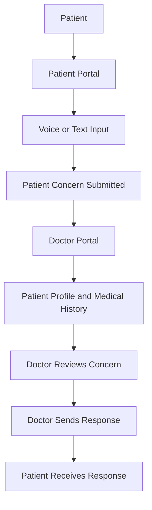

# 🩺 Care — Healthcare, Connected.

### A smarter communication bridge between patients and doctors.

**Care** is a patient-doctor communication platform designed to make healthcare interactions simpler, faster, and more informed.

Patients can describe their health concerns using **voice or text**, while doctors get access to a dedicated portal containing patient profiles, medical history, previous consultations, and records — allowing them to understand the situation and respond efficiently without repeatedly asking for the same information.

> Less paperwork. Better context. More meaningful healthcare.

---

## ✨ The Vision

Traditional healthcare communication often lacks continuity. Patients repeatedly explain their symptoms, doctors spend valuable time collecting background information, and important medical context can get scattered across different consultations.

**Care aims to solve this by bringing patient communication and medical history into one connected platform.**

## 🚀 Core Features

### 👤 Patient Portal

A simple and accessible interface for patients to communicate their health concerns.

- 🎙️ **Voice-Based Input** — Describe symptoms naturally using voice.
- 💬 **Text-Based Input** — Submit health concerns through text.
- 📋 **Medical History** — Access personal medical records and previous consultations.
- 📩 **Doctor Responses** — Receive responses and updates from the doctor.
- 🗂️ **Consultation History** — Keep track of previous interactions.

### 🩺 Doctor Portal

A dedicated workspace designed to help doctors manage patient communication efficiently.

- 👥 **Patient Profiles** — Access patient details from a centralized dashboard.
- 📚 **Medical History** — View previous consultations and available medical records.
- 📝 **Patient Complaints** — Read patient concerns submitted through voice or text.
- ⚡ **Efficient Responses** — Respond with relevant patient context already available.
- 📊 **Patient Overview** — Understand the patient's history before responding.

---

## 🔄 How Care Works



The key idea is simple: **the doctor doesn't start every interaction from zero.**

Patient information and previous records are already available in the doctor's workspace, helping reduce repetitive communication and improve continuity.

---

## 🏗️ Platform Architecture

Care consists of two separate interfaces connected through a shared backend.

| Component        | Responsibility                                      |
| ---------------- | --------------------------------------------------- |
| Patient Portal   | Symptom submission and communication                |
| Doctor Portal    | Patient management and responses                    |
| Backend          | Authentication, data processing and APIs            |
| Database         | Patient profiles, medical history and consultations |
| Voice Processing | Converting spoken concerns into usable text         |

---

## 🛠️ Tech Stack

> Update this section according to the actual technologies used in the project.

| Layer            | Technology |
| ---------------- | ---------- |
| Frontend         | typescript |
| Backend          | typescript |
| Database         | supabase   |
| Authentication   | supabase   |
| Voice Processing | gemini     |

---

## 📁 Project Structure

```text
Care/
│
├── patient-portal/
│   ├── components/
│   ├── pages/
│   └── assets/
│
├── doctor-portal/
│   ├── components/
│   ├── pages/
│   └── assets/
│
├── backend/
│   ├── routes/
│   ├── controllers/
│   ├── models/
│   └── services/
│
├── README.md
└── ...
```

*The structure above is an illustrative layout. Adapt it to the actual repository.*

---

## 🔐 Privacy & Security

Healthcare information is sensitive. Care is designed around the importance of:

- Secure authentication and role-based access.
- Protecting patient medical records.
- Ensuring patients' information is accessible only to authorized users.
- Maintaining confidentiality across patient-doctor interactions.

---

## 🎯 Our Goal

Care isn't just another messaging platform.

It's an attempt to make healthcare communication more accessible for patients and more efficient for doctors by ensuring that **every conversation has the context it needs.**

### Built with ❤️ for better healthcare communication.

---

*Care — Because better healthcare starts with better communication.*
